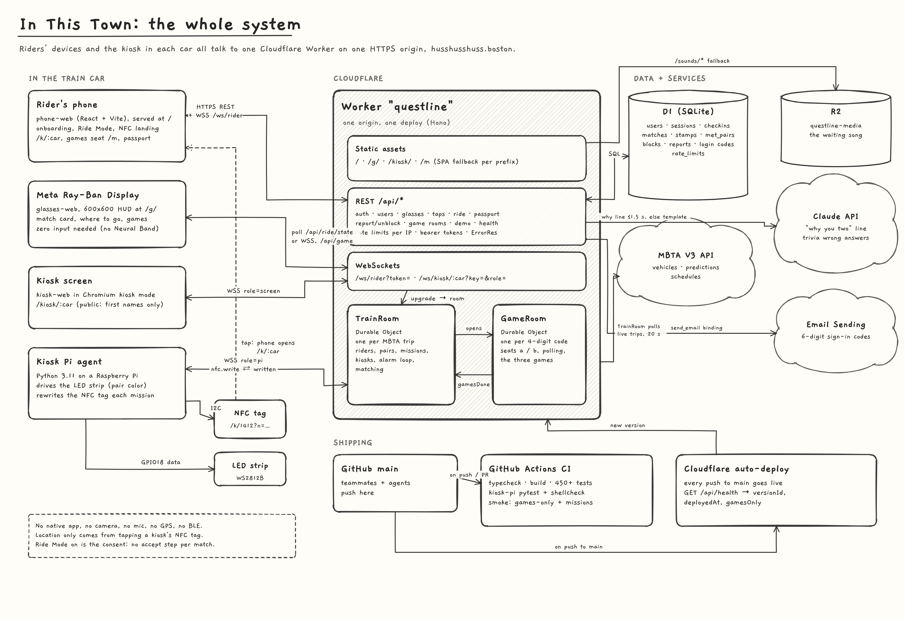
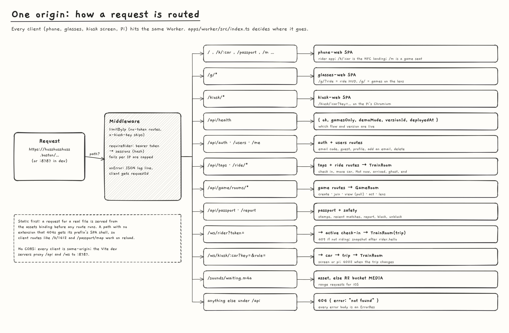
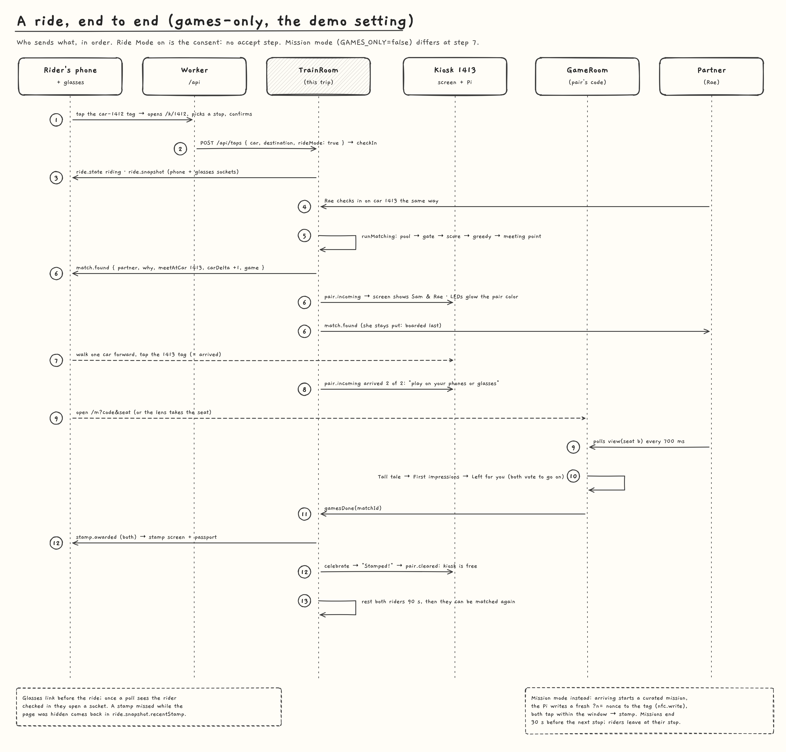
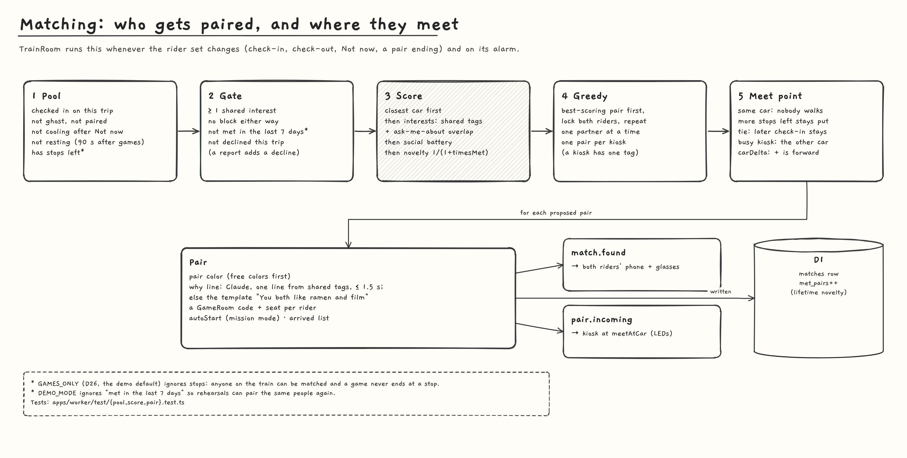
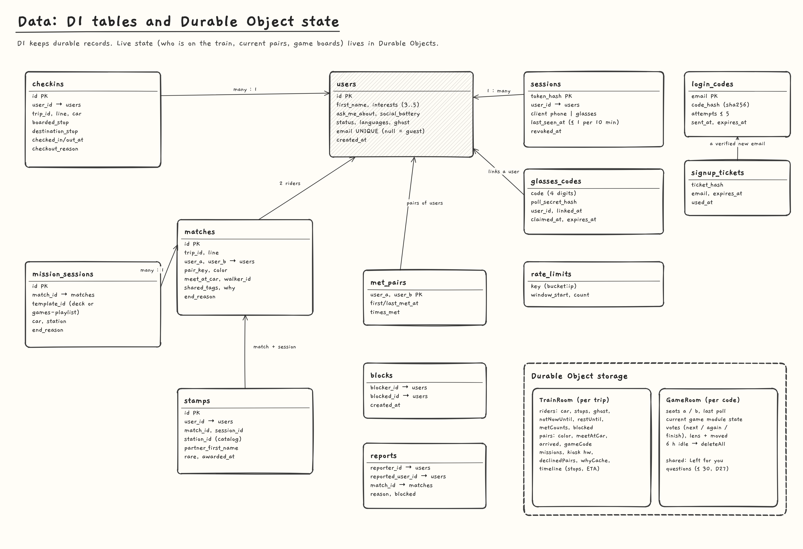
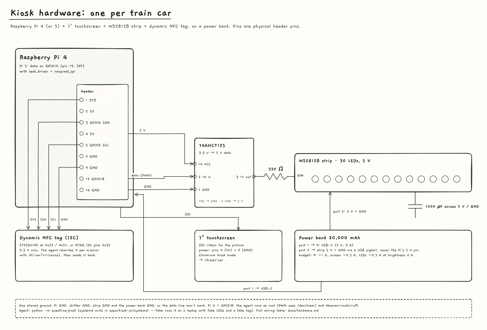
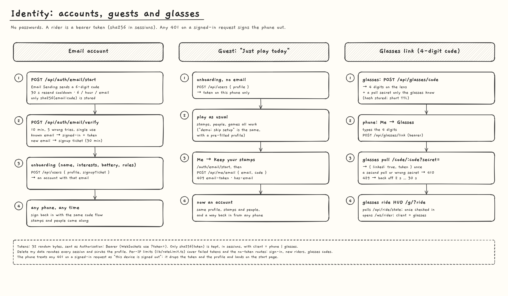
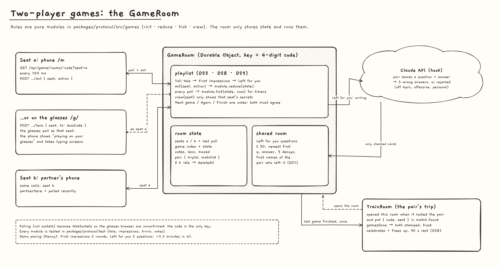
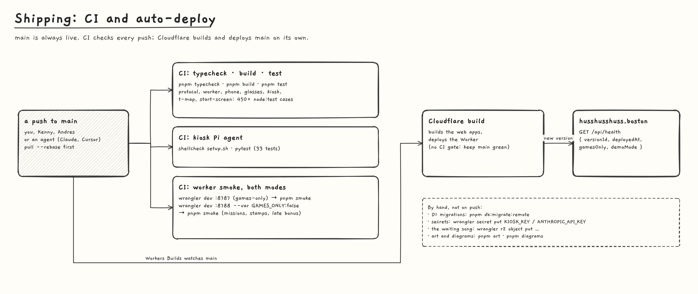

# In This Town (repo: this-town)

In This Town turns your ride on the T into a quick game with the right stranger. Turn on Ride Mode and you get matched with the closest rider on your train who shares your interests. Your phone (or your Meta Ray-Ban Display glasses) shows who and where to go. The kiosk in that train car glows your pair's color, and the two of you play three short two-player games. Finish them and you both get a stamp for your passport.

**The phone decides who. The glasses and the kiosk make it happen.**

Code identifiers keep the old name, Questline (`@questline/*`, the `questline` database), per decision D16.

## How it works

1. **Onboard once** on your phone: first name, interests, an optional "ask me about", and your social battery. Or tap "Just play today" to play as a guest and add an email later to keep your stamps.
2. **Board and tap** the NFC tag on your car's kiosk. Pick your stop and turn on Ride Mode. That checks you in, and Ride Mode on is the consent: there is no accept step.
3. **Get matched** with the closest rider on the same train who shares an interest. You get their first name, your pair color, one line about why you two, and where to meet ("kiosk 1 car forward"). "Not now" is one tap.
4. **Meet at the kiosk.** Its screen shows your first names and its LEDs glow your color. Tap its tag when you get there.
5. **Play** Tall tale, then First impressions, then Left for you, on your phones or your glasses.
6. **Get stamped.** Finishing the games stamps you both, the kiosk celebrates, and after a 90-second rest you can be matched again (D28).

Games-only is the default and the demo setting (`GAMES_ONLY`, D26). With `GAMES_ONLY=false`, the kiosk runs a curated mission that must end before the next stop instead, and you both tap a freshly written tag to get stamped.

## Diagrams

Every diagram below is drawn by [`scripts/diagrams.mjs`](scripts/diagrams.mjs): pencil strokes plus the Gaegu handwriting font the app uses. Run `pnpm diagrams` to redraw them all after a change (`pnpm diagrams ride-flow` redraws one). Each has an SVG (font embedded) next to its PNG in [`docs/diagrams/`](docs/diagrams). [`docs/architecture.md`](docs/architecture.md) stays the source of truth for details.

### 1. The whole system

One Cloudflare Worker serves the three web apps and the API. A `TrainRoom` Durable Object per trip holds live state (riders, pairs, matching), and a `GameRoom` per pair code runs the games. D1 keeps durable records; MBTA, Claude, Email Sending and R2 sit at the edges.



### 2. Routing inside the Worker

Every route, where it goes, and what guards it: bearer tokens, the kiosk key, per-IP rate limits, and the demo-only routes.



### 3. A ride, end to end

Who sends what, in order, from the first tag tap to the stamp and the 90-second rest. Dashed arrows are things people do (walk, open a page), not messages.



### 4. Matching

The five stages `TrainRoom` runs whenever the rider set changes: pool, gate, score, greedy, meeting point. Then what each new pair gets.



### 5. Data model

Every D1 table, the keys between them, and the state that lives only in Durable Object storage.



### 6. Kiosk hardware

The wiring for one car: Raspberry Pi header pins, the 74AHCT125 level shifter, the 330 Ω resistor and 1000 µF capacitor on the WS2812B strip, the I2C dynamic NFC tag, the DSI touchscreen and the power bank. Full table in [`docs/hardware.md`](docs/hardware.md).



### 7. Identity

No passwords. Email accounts use a 6-digit code, guests can add an email later, and glasses link with a 4-digit code on the lens.



### 8. The games

How phones and glasses play through the `GameRoom`: pure game modules, votes to move on, the shared "Left for you" questions checked by Claude, and `gamesDone` back to the `TrainRoom`.



### 9. Shipping

CI runs on every push. Cloudflare builds and deploys `main` on its own, so `main` must stay green.



## Repo layout

```
apps/
  worker/        Cloudflare Worker: Hono API, D1, TrainRoom + GameRoom Durable Objects, serves the web apps
  phone-web/     Rider phone app (onboarding, Ride Mode, tag landing, games, passport, people, me)
  glasses-web/   Meta Ray-Ban Display Web App (600x600 HUD and the games on the lens)
  kiosk-web/     Kiosk touchscreen UI (Chromium kiosk mode on the Pi)
  kiosk-pi/      Python agent on the Pi (LED strip, dynamic NFC tag)
packages/
  protocol/      Shared zod schemas for REST + WebSocket events, and the game modules
  t-map/         The T map (SVG) and the catalog of all 124 subway and light-rail stations
  start-screen/  The 3D start screen (three.js) and the renderer behind the app's artwork
scripts/         Seed, ghost riders, smoke test, asset build, diagrams
docs/            Architecture, decisions, hardware, phone flow, demo script, diagrams
```

## Quick start

```bash
pnpm install
pnpm db:migrate:local
pnpm dev
```

- Phone: http://localhost:5173
- Glasses: http://localhost:5174/g/?ride for the ride HUD, http://localhost:5174/g/ for the games (resize the window to 600x600; the second player joins at http://localhost:5173/m)
- Kiosk: http://localhost:5175/kiosk/1412
- Worker: http://localhost:8787

Other commands: `pnpm seed` (demo profiles), `pnpm ghosts` (fake riders on the demo train), `pnpm smoke` (end-to-end check against a running worker), `pnpm art` (re-render the app's artwork), `pnpm diagrams` (redraw the diagrams above).

Each app's README has details. The Pi setup is in `apps/kiosk-pi/README.md` and `docs/hardware.md`.

## Docs

- [Architecture](docs/architecture.md)
- [Decisions](docs/decisions.md)
- [Phone flow](docs/phone-flow.md)
- [Hardware](docs/hardware.md)
- [Demo script](docs/demo-script.md)
- [v1 spec (archived, outdated)](docs/archive/questline-spec-v1.md)

## Stack

TypeScript, React + Vite, three.js, Hono on Cloudflare Workers, D1, Durable Objects, R2, Cloudflare Email Sending, MBTA V3 API, Claude API. Python on the Raspberry Pi.
