**Track: Transit Gamification** · Live at [husshusshuss.boston](https://husshusshuss.boston) · Code on [GitHub](https://github.com/cjxsez/this-town)

## Inspiration

The track brief says it plainly: *"Hundreds of thousands of people use the MBTA every day,"* and the T is *"one of Boston's greatest shared spaces, yet the daily journey remains an untapped opportunity for connection."*

Every one of us has spent a Green Line ride three feet from a stranger with the same band on their tote bag, and never said a word. That's normal on a train. Nobody wants a dating app on the T. But a reason to say hi, a fixed place to meet, and something to do for three minutes? That could make the ride the best part of the day. **[confirm, or swap in a real moment from your team]**

So we built a game that only works if two strangers on the same train play it together, and that leaves the T a little friendlier for the next pair.

## What it does

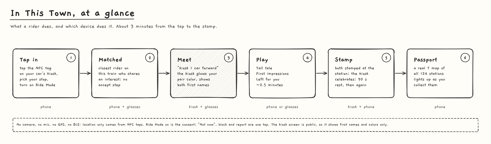

**1. Tap in.** Every train car has a kiosk with an NFC tag. Tap it with your phone and the app opens; there's nothing to install. Pick your stop and turn on **Ride Mode**. That one deliberate yes is the consent: no swiping, no accept step.

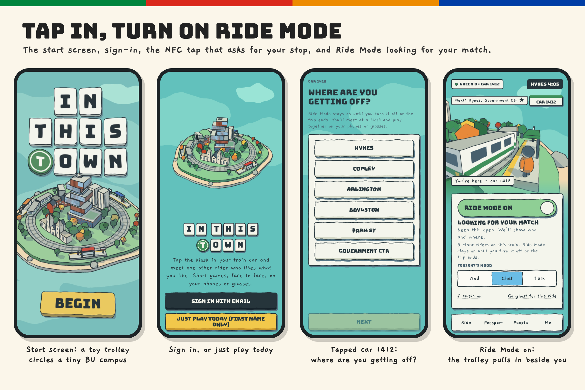

**2. Get matched.** You're paired with the closest rider on the same train who shares at least one interest. You get their first name, a pair color, one line on why you two ("You both like ramen and coffee"), and where to meet: *kiosk 1 car forward*. The match shows on your phone, on your **Meta Ray-Ban Display** glasses if you wear them, and on the kiosk itself.

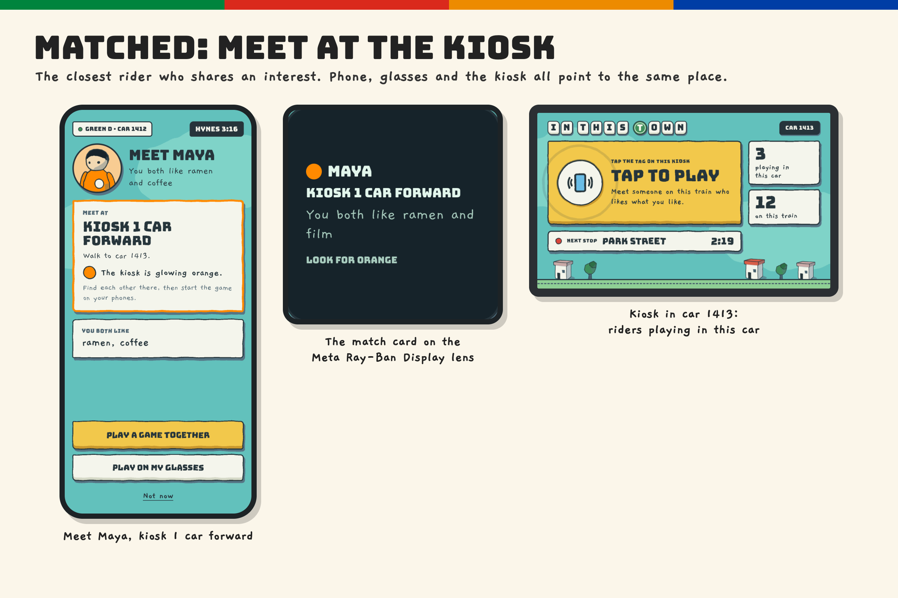

**3. Play three games, about 2.5 minutes in all.**

- **Tall tale.** A secret card says *truth* or *make it up*. You get 7 s to think and 18 s to tell your worst T story. Your partner has 7 s to call it.

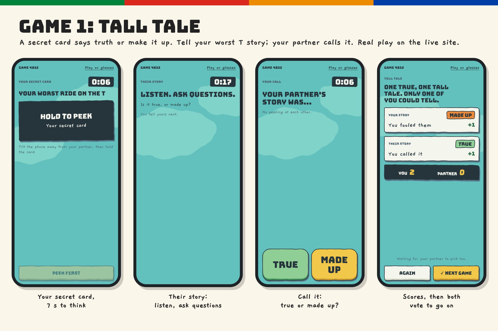

- **First impressions.** Two rounds of guessing things about each other ("How does your partner feel about pineapple on pizza?"). You only see what your partner guessed about *you*, then tell them the real answer.

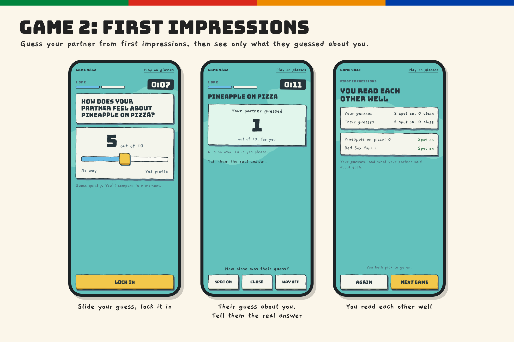

- **Left for you.** Trivia about Boston and the T, written by the *previous* pair on the train ("Left for you by Andres and Kenny"). Then you get 30 s to leave one for the next pair. You write the question and the answer; Claude writes the wrong answers.

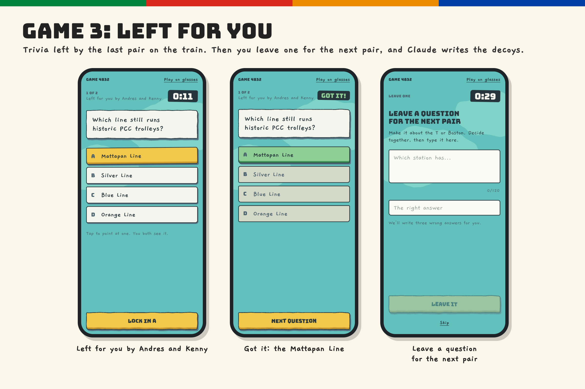

Moving on is a vote: both players have to pick *Next game*, so nobody gets dragged along.

**4. Get stamped.** Finishing stamps you both at the station. The kiosk bursts into your pair color, and rare stamps go gold.

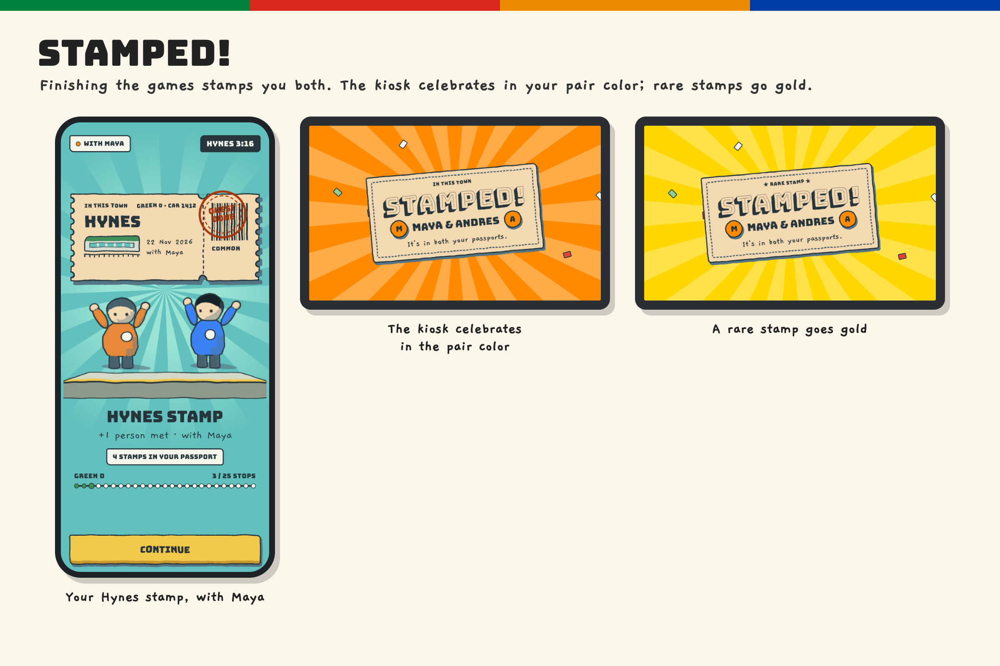

**5. Collect the whole T.** Your **Passport** is a real map of all **124** subway and light-rail stations. Stamped stations light up, and each line is a rail of tickets. **People** lists who you met, by first name only.

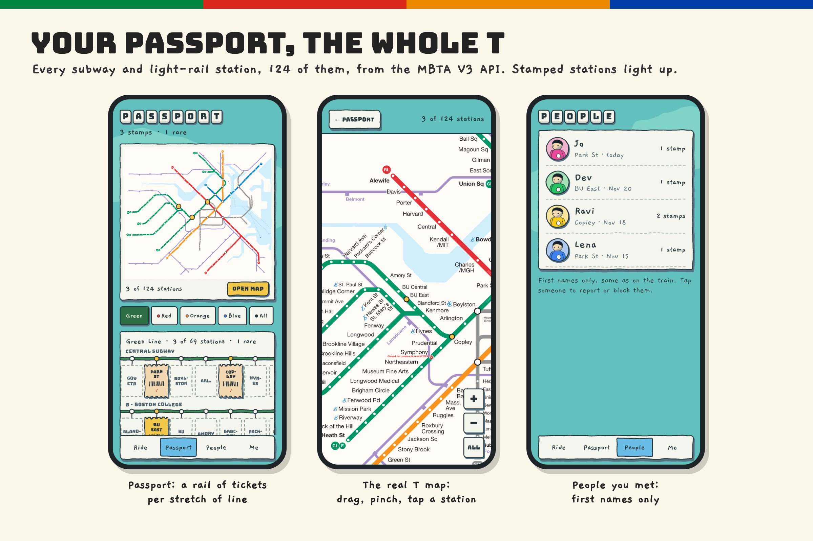

Every screenshot above comes from the real app. The game boards were captured while playing a live room on husshusshuss.boston.

## How we built it

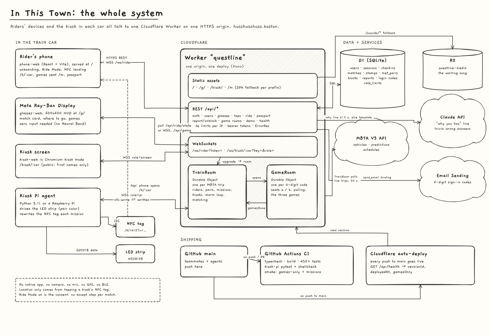

### Design first

We started with pencil wireframes of the eight screens that matter, then a 3D start screen: a toy trolley circling a tiny BU campus with the CDS building in the middle. Every picture in the app is rendered by that same three.js renderer, so the whole thing feels like one place.

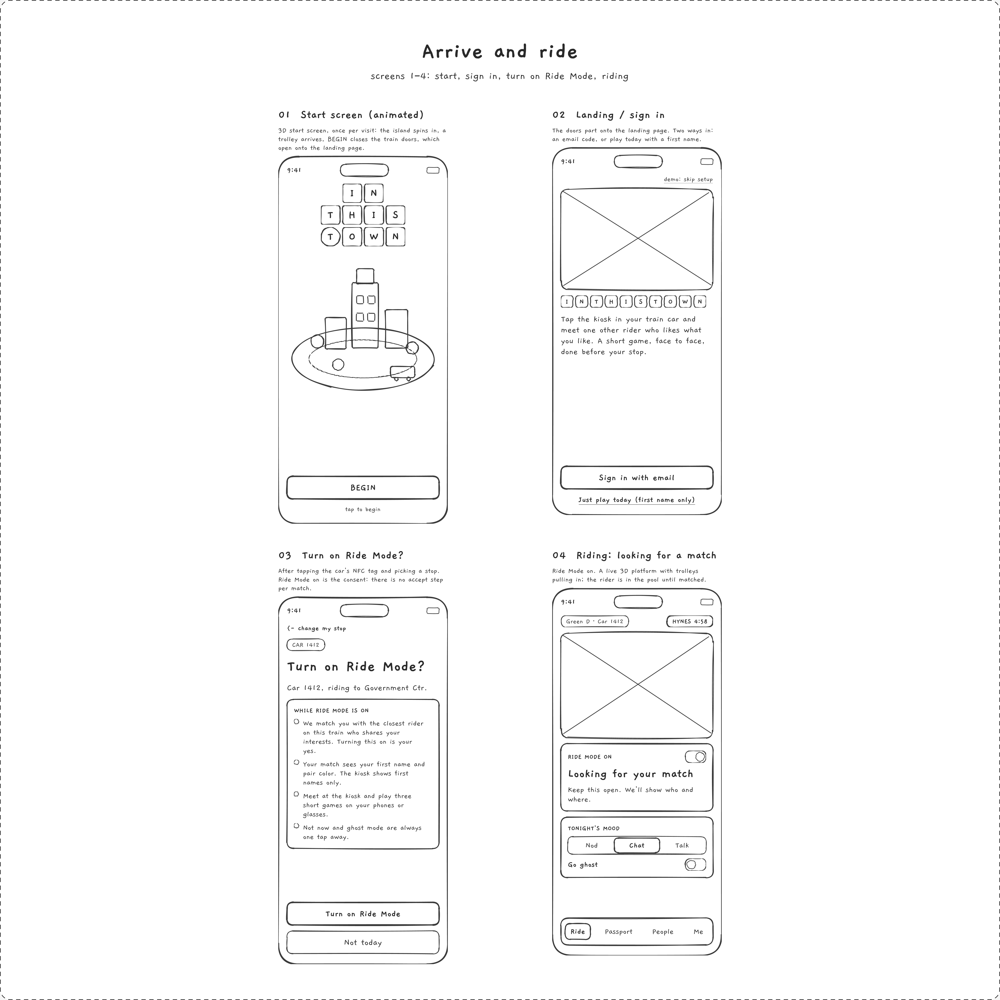

### One Worker, five apps

- **Cloudflare Worker (Hono).** One Worker serves everything from one HTTPS origin: the phone app (React + Vite), the glasses app (600×600, black background), the kiosk screen (800×480 stage) and the API. *Why:* the glasses Web App and the NFC links both need one origin, and one deploy is one thing to break.
- **Durable Objects.**
  - `TrainRoom`, one per trip, holds who's in which car, the pairs and the matching loop. Phones, glasses and kiosks connect to it over WebSockets.
  - `GameRoom`, one per pair, keyed by a 4-digit code.

  *Why:* each train and each game is one live room that must stay consistent, which is exactly what a Durable Object is.
- **Games are pure functions.** Each game is a TypeScript module (`init / reduce / tick / view`) in a shared protocol package. The room only stores state and runs it, and `view(seat)` hides the other player's secrets. *Why:* phone and glasses always draw the same state, and every rule is unit-tested without a server.
- **One contract.** Every REST body and WebSocket event is a zod schema in `packages/protocol`. The worker and four clients import it, so they can't drift apart.
- **D1** holds riders, check-ins, matches, stamps, met pairs, blocks, reports and rate limits.
- **R2** serves the waiting song that plays while you're looking for a match.

### Matching

Matching runs whenever the rider set changes:
1. **Pool:** everyone checked in, not resting, and not in ghost mode.
2. **Gate:** at least one shared interest, no block either way, and not met in the last 7 days.
3. **Score:** closest car first, then shared interests, social battery, and novelty `1/(1+timesMet)`.
4. **Greedy pairing:** one pair per kiosk.
5. **Meeting point:** whoever boarded last stays put, and the other walks.

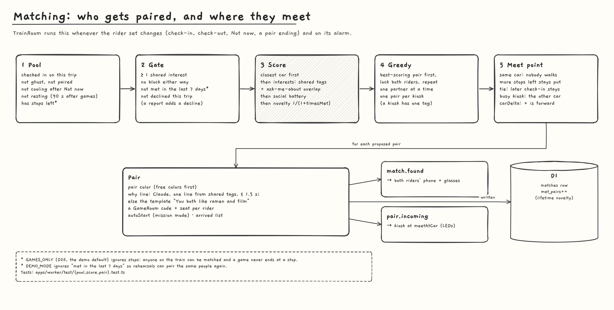

### The kiosk

**Hardware:**
- a Raspberry Pi with a 7" touchscreen (Chromium in kiosk mode)
- a WS2812B LED strip, with 3.3 V data lifted to 5 V through a 74AHCT125
- a 330 Ω resistor and a 1000 µF capacitor
- a dynamic NFC tag on I2C (ST25DV or NTAG I2C plus)
- a power bank

**The Python agent:**
- listens to the train room over a WebSocket
- plays LED animations in the pair color
- can rewrite the tag with a fresh nonce each round, so a photo of an old tag can't be replayed

**[confirm what was physically built]**

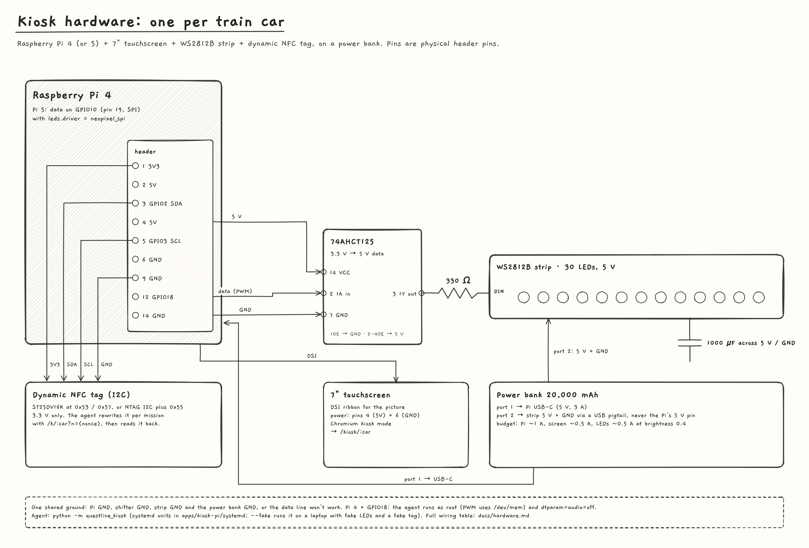

### Shipping

GitHub Actions runs on every push:
- typecheck, build and **450+ tests**
- the Pi agent's pytest suite, plus shellcheck
- a headless **end-to-end smoke ride** in both game modes: check-in, match, all three games, Finish, stamp

Cloudflare Workers Builds then deploys `main` by itself, so `main` is always the live site. `GET /api/health` reports the running version.

## Privacy by design

- No camera, no mic, no GPS, no BLE. Location only comes from tapping a tag, which also works underground.
- Ride Mode is confirmed on every ride (18+, "Ride Mode on means I can be matched").
- *Not now*, block and report are one tap each, and reporting can block in the same step.
- The kiosk screen is public, so it only ever shows first names and colors.
- No passwords: sign in with a 6-digit email code, or play as a guest and add an email later to keep your stamps.

---

# Tracks & tools

## Transit Gamification

The track asks: *"How can we transform the common T ride from something that is dreaded to something people can look forward to?"* Here's how each part of our answer maps to the brief:

| The brief says | In This Town |
|---|---|
| "one of Boston's greatest shared spaces" | The game *needs* the stranger next to you. It's the only multiplayer game where the lobby is a train car. |
| "untapped opportunity for connection" | Matching picks the closest rider who shares an interest, and the kiosk gives you a place to meet. |
| "same predictable routine, platform waits" | The ride becomes a collection: 124 stations to stamp, line progress, and rare gold stamps. |
| "for tourists… disconnected from the city above ground" | The Passport is a real T map, and Left for you trivia is all about Boston and the T. |
| "something people can look forward to" | Left for you chains riders together: every pair plays the last pair's question and leaves one for the next. |

**The gamification loop:**
1. **Ride Mode** is the session.
2. **The match** is the quest.
3. **The kiosk** is the meeting point.
4. **Three games** are the play.
5. **The stamp** is the reward.
6. **The Passport** is long-term progress.

Rare stamps, line progress bars and pair colors give it texture. A 90-second rest after each pair keeps the game social rather than grindy.

**What the demo shows:** two riders tap kiosks in cars 1412 and 1413. They're matched in seconds, the 1413 kiosk lights up orange, and they play all three games on their phones (or one on the glasses). Finish stamps both of them, and the kiosk celebrates.

## Built with Cursor

Cursor was a core teammate on this project. **109 of the 250+ commits on `main` are by Cursor's agent.** That's over 40% of the repo's history, landed in one overnight push of about 3 h 20 min: 220 file changes, +5,644 / −973 lines.

### How we worked with it

1. **A spec, not a chat.** We wrote `docs/handoff.md`, a 266-line build plan in seven sections: kiosk Pi agent, live MBTA trips, glasses, phone, kiosk screen, ops, and tests and CI. Each section names the files to touch, the exact behavior, and a definition of done.
2. **Batches.** We prompted Cursor's background agent one section at a time from the Cursor web app, and opened the next batch once the last one was green. Claude Code, in the terminal, helped draft the prompts and review the diffs. A human approved the direction.
3. **One behavior per commit.** We asked Cursor for small, atomic commits whose message says what the system now does ("Kiosk LEDs burst white from the center when a stamp is awarded"). That made 109 commits reviewable and easy to revert.
4. **CI is the gate.** Every Cursor push ran the full pipeline: typecheck, build, 450+ tests, the Pi tests, and the smoke ride in both modes. `main` auto-deploys, so red was not an option. When a teammate's game-pacing change broke the smoke test, Cursor fixed the smoke test and CI the same night.

### What Cursor built

- **The kiosk's Raspberry Pi agent** (about 30 commits):
  - **LED animations:** idle breathing in the idle color, a pulse in the pair color, a white burst on a stamp, a rainbow on a rare stamp, and a flash on the first tap.
  - **Two WS2812 drivers:** PWM on GPIO18 through `rpi_ws281x`, and SPI on GPIO10 without root for the Pi 5.
  - **The socket loop:** hello, app-level ping, reconnect with backoff, immediate reconnect on a trip change, and a clean shutdown that clears the LEDs on SIGINT/SIGTERM from systemd.
  - **Dynamic NFC tag writers** for NTAG I2C and ST25DV. They write an NDEF URI with a fresh nonce, then read it back to verify, with I2C retries.
  - **A Chromium launcher** that waits for X or Wayland and clears crash-restore flags.
  - **Tests,** including a WebSocket integration test for hello, `nfc.written`, the 4002 reconnect and the 1001 shutdown.
- **Live MBTA trips:**
  - car labels resolve to a trip through a 10 s vehicles cache
  - predictions are polled every 20 s and mapped onto our 124-station catalog
  - polling honors `Retry-After` and backs off from 20 s to 2 min, without ending the trip
  - the tests replay recorded fixtures
- **The glasses app:**
  - a screen wake lock, and countdowns synced to the worker's clock
  - WebSocket close-code handling with a REST fallback, paused while the page is hidden
  - a crash screen that reloads, and backoff on link rate limits
  - the rare-stamp accent
  - a stamp missed while the page was hidden is recovered from the ride snapshot
  - pure state reducers with unit tests
- **The kiosk screen:**
  - an error boundary that reloads itself (the screen is unattended)
  - the kiosk key is stripped from the URL, and the screen reloads after five minutes offline
  - a "How it works" overlay and accessible labels
- **Matching and safety:**
  - lifetime novelty in the score
  - per-IP limits on the game routes
  - a 4 KB cap on game actions (413)
  - rate limits on failed bearer-token lookups
  - idle game rooms deleted after 6 h
- **Game rules:** the vote logic behind *Next game / Again / Finish* (D29), with protocol and worker tests.
- **CI:** the smoke ride in **both** game modes on separate ports, shellcheck for the Pi setup script, and a test that fails if `wrangler.toml` and the code's `Env` drift apart.
- **Games-only copy:** 13 commits making every phone, glasses and kiosk screen describe the games-only demo correctly.
- **Ops:** `/api/health` reports `versionId` and `deployedAt`, so we can see which build is live.

### What we learned about building with Cursor

- **A written spec with a definition of done beats a conversation.** Cursor stayed on task for hours because the task was on disk.
- **Atomic commits make an agent's work reviewable.** We could read 109 commit messages like a changelog.
- **Tests are how you trust an agent.** The smoke ride caught every regression before it reached the live site.

## GoDaddy Registry: husshusshuss.boston

We registered **husshusshuss.boston** during the hackathon (Nov 21, 7:34 PM EST). GoDaddy Registry runs the `.boston` domain ending, and it's the only home the project has:

- **The NFC tags** on every kiosk point to it: `husshusshuss.boston/k/1412`. Tap the tag and the app opens.
- **The glasses** run at `husshusshuss.boston/g/` and the **kiosk screen** at `husshusshuss.boston/kiosk/1413`. All of it comes from one origin.
- **Sign-in codes** are emailed from the same domain, using Cloudflare Email Sending with SPF and DKIM.
- A `.boston` address on a sticker in a Green Line car tells riders exactly where they are before they tap.

## Claude (Anthropic)

Claude has exactly two jobs, and never writes a fact:

1. **"Why you two."** One line from the pair's shared interests. It has a hard 1.5 s timeout and a template fallback, so matching never waits on a model.
2. **Left for you.** A pair writes a question and its right answer. Claude writes three plausible wrong answers and can turn the question down if it's off-topic, offensive or personal. Nothing is saved without that check.

Missions and game decks are curated by hand.

---

## Challenges we ran into

- **"Which person is it?"**
  - First we planned camera lock-on: but glasses Web Apps get no camera.
  - Then BLE beacons: but background BLE on iPhone is unreliable.
  - Then UWB arrows: but UWB direction is flaky.

  So we flipped it: **meet at a fixed, glowing kiosk.** That answered "which person," gave the pair a shared screen, and became our hardware.
- **Glasses with zero input.** We had no Neural Band, so arriving means tapping the kiosk, and the lens follows the game on its own. Games poll every 700 ms because WebSockets on the glasses browser were unconfirmed.
- **A game that ends.** At first the games looped forever, so pairs never finished and kiosks never freed up. We made moving on a vote, added Finish, the stamp and a 90 s rest. Then we cut all three games to fit 150 s of timed play.
- **Trains aren't connected.** Green Line cars have no passage between them, so for filming, "car 1412" and "car 1413" are the two ends of one car.
- **Four clients, one weekend.** Phone, glasses, kiosk screen and Pi all speak one protocol. Without the shared zod package and the smoke ride in CI, we'd have shipped mismatches.

## Accomplishments that we're proud of

- The whole loop runs live on one origin: tap, match, meet, three games, stamp, Passport. Every screenshot here is from the real app.
- **Left for you:** every pair leaves something for the next pair on the train.
- The kiosk idea came out of a dead end, and it's better than anything we planned.
- **250+ commits in a weekend.** 109 of them are Cursor's, and every push was tested by a headless ride.
- 30 design decisions logged in `docs/decisions.md`, so anyone can see why it works the way it does.

## What we learned

- Constraints make better designs. Losing the camera, BLE and GPS gave us the kiosk.
- One shared protocol package is worth its weight across five codebases.
- Keep the LLM on a short leash: a timeout, a fallback, and never the source of truth.
- An agent like Cursor is as good as the spec and the tests around it.

## What's next for In This Town

- A pilot on a real Green Line car, with BU Spark! or the MBTA.
- Live train positions from the MBTA vehicle feed by default (Cursor already wired it), instead of our scripted demo trip.
- Group games for 3–4 riders, themed weeks (Marathon Monday), and accessibility passes on the kiosk.

**What's real and what's simulated in the demo:**
- **Real:** the app, matching, all three games, stamps and the Passport.
- **Simulated:** the demo trip follows a scripted Green Line schedule, and extra riders on the train are "ghost" bots.
- **[confirm]:** glasses touch input during games. The phone can always take the seat.
